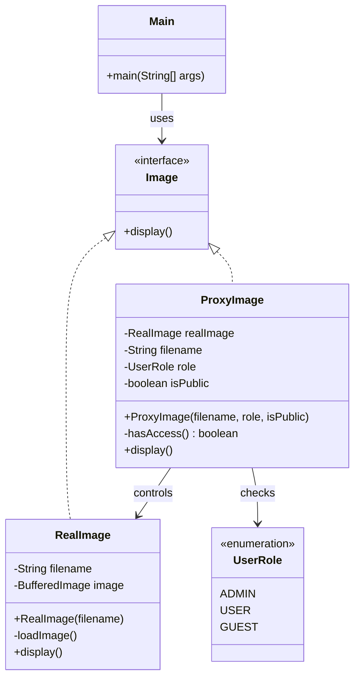

# 🚀 Proxy Pattern Project

### Lazy Loading of Heavy Images and Access Control

---

## 📌 Project Description

This project demonstrates the Proxy Design Pattern
using Java programming language.

The system provides lazy loading of images and
controls access permissions based on user roles.

Images are loaded only when requested by an authorized user.

## 🎯 Project Objectives

- Implement Proxy Design Pattern
- Demonstrate Lazy Loading
- Control access to images
- Reduce unnecessary image loading
- Manage user permissions

## 🛠 Technologies

- Java 17
- Maven
- IntelliJ IDEA
- Java Swing
- GitHub

## 🧩 Design Pattern

The project uses the Proxy Pattern.

ProxyImage acts as an intermediary between the client
and RealImage.

### Main Components

| Class | Description |
|---|---|
| Image | Common interface |
| RealImage | Loads and displays images |
| ProxyImage | Controls access and lazy loading |
| UserRole | Defines user roles |
| Main | Starts the application |

## 🔐 Access Control

| User Role | Permissions |
|---|---|
| ADMIN | Access to all images |
| USER | Access to public images |
| GUEST | Access denied |

## ⚡ Lazy Loading

Lazy Loading means that images are not loaded
immediately when objects are created.

The image is loaded only when the display()
method is called and access is granted.

## 🖼 Project Images

### Nature


### Landscape


### Secret


## 📂 Project Structure

```text
ProxyPatternProject/
├── src/
│   └── main/
│       ├── java/
│       │   └── kz/onestep/proxypatternproject/
│       │       ├── Image.java
│       │       ├── RealImage.java
│       │       ├── ProxyImage.java
│       │       ├── UserRole.java
│       │       └── Main.java
│       └── resources/
│           └── images/
│               ├── nature.png
│               ├── secret.png
│               └── landscape.png
├── pom.xml
└── README.md
```

## ▶️ How to Run

1. Clone the repository.
2. Open the project in IntelliJ IDEA.
3. Configure Java 17.
4. Open Main.java.
5. Click Run.

## 👩‍💻 Author

GitHub: [Zhanarrash](https://github.com/Zhanarrash)

Project: ProxyPatternProject

---

**Proxy Pattern | Java Design Patterns**

## 📊 UML Class Diagram



## 🏗 Architecture

The ProxyImage class controls access to RealImage.
It implements Lazy Loading and Access Control.

The RealImage object is created only when an
authorized user requests the image.
